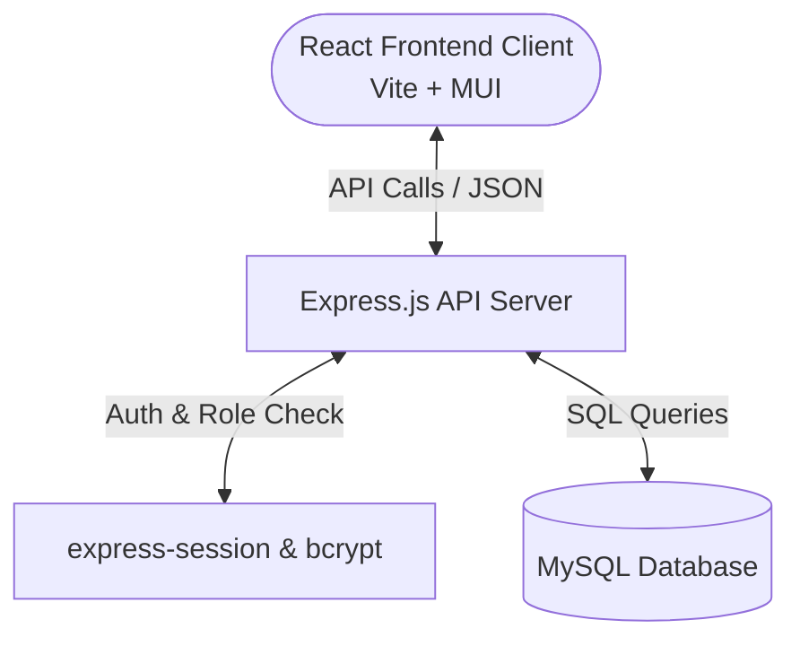

#  Department Student Research & Academic Activity Management Portal 🚀

[-blue.svg)](https://react.dev)
[](https://expressjs.com)
[](https://www.mysql.com)
[](LICENSE)

A modern, full-stack Academic Portal designed for departments to coordinate, monitor, and manage student-led academic achievements, research papers, publications, and external events like hackathons.

---

## 🏛️ Application Architecture



---

## ✨ Features

- **🔒 Secured Authentication & RBAC**:
  - Secure signup/login using bcrypt passwords.
  - Role-Based Access Control (RBAC) with three distinct levels: **Student**, **Staff/Faculty**, and **Admin**.
- **📝 Academic Activity Registry**:
  - Add, edit, and categorize activities (Conferences, Publications, Patents, Hackathons, Projects).
  - Submit documents, journals, and event dates for approval.
- **📊 Comprehensive Dashboards**:
  - **Student Dashboard**: Tracks personal activity submissions, project summaries, and progress.
  - **Staff Dashboard**: Reviews, approves, or rejects student submissions within their domain.
  - **Admin Dashboard**: Manages users, configuration parameters, and accesses system logs.
- **🗃️ Automatic Database Initialization**:
  - Instant structure setup and seed data load using a single script execution.

---

## 📁 Repository Structure

```
UG-research-management/
├── backend/               # Node.js + Express API Backend
│   ├── middleware/        # Authentication & Authorization guards
│   ├── routes/            # REST API route controllers
│   ├── db.js              # MySQL connection pool
│   ├── init-db.js         # Auto-schema creation script
│   ├── schema.sql         # Raw MySQL database schema
│   ├── server.js          # Main Express server entrypoint
│   └── .env.example       # Template environment variables
└── frontend/              # React.js Vite Frontend App
    ├── src/
    │   ├── components/    # Reusable layout and modal components
    │   ├── context/       # AuthState management
    │   ├── pages/         # Dashboard views & forms
    │   ├── App.jsx        # Routing configuration
    │   └── main.jsx       # Theme and mount configuration
    └── index.html
```

---

## ⚙️ Local Configuration & Setup

### Prerequisites
Make sure **Node.js** (v18+) and **MySQL** are installed and running locally.

### 1. Backend Environment Setup
Navigate to the `backend/` directory and configure the environment variables:
```bash
cd backend
cp .env.example .env
```
Update `.env` with your local MySQL credentials:
```env
PORT=5000
DB_USER=root
DB_PASSWORD=your_password_here
DB_HOST=127.0.0.1
DB_PORT=3306
DB_NAME=academic_portal
SESSION_SECRET=super_secret_academic_session_key
```

### 2. Install Dependencies & Build
Install libraries for both packages:
```bash
# Install backend dependencies
cd backend
npm install

# Install frontend dependencies
cd ../frontend
npm install
```

### 3. Initialize Database Tables
Run the automatic database initializer script from the `backend/` directory to create databases, tables, and mock data:
```bash
cd ../backend
node init-db.js
```

---

## ▶️ Run Application

Start the **Backend Server**:
```bash
cd backend
npm run dev
```
*API runs at http://localhost:5000*

Start the **Frontend Development Client**:
```bash
cd frontend
npm run dev
```
*Frontend runs at http://localhost:5173*

---

## 🔑 Demo Access Accounts

The database seed script generates the following test users:

| Role | Email | Password |
| :--- | :--- | :--- |
| **Admin** | `admin@test.com` | `admin123` |
| **Staff/Faculty** | `staff@test.com` | `staff123` |
| **Student** | `student@test.com` | `student123` |
